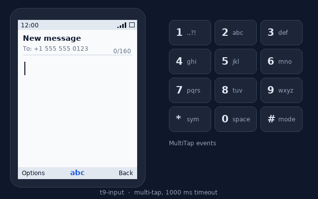
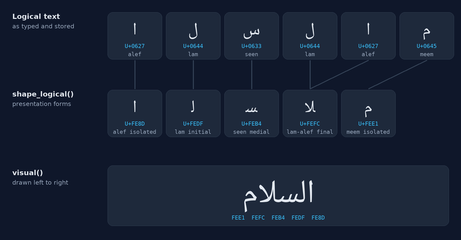
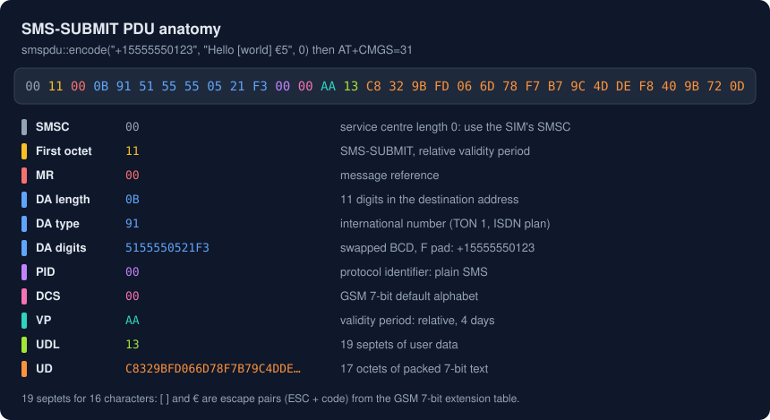
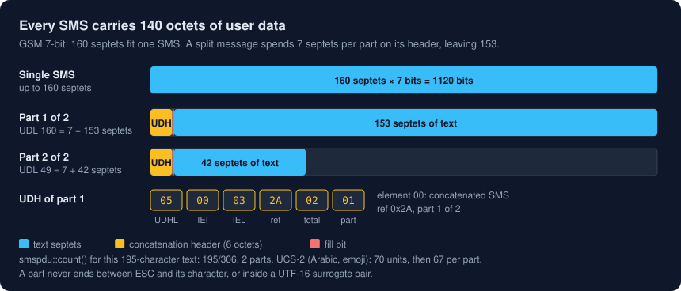

# featurephone-kit

Small, dependency-free, `no_std`-friendly Rust crates for building keypad
feature phones and other tiny devices.

They were extracted from **WeaverOS**, an OS for a keypad feature phone, where
they drive the on-screen UI, the cellular modem's SMS path and the bitmap-font
text renderer.

| Crate | What it does |
| --- | --- |
| [`t9-input`](crates/t9-input) | Multi-tap and predictive (T9) keypad text input, with Latin and Arabic keypad layouts. |
| [`smspdu`](crates/smspdu) | SMS PDU encode/decode (3GPP TS 23.040/23.038): GSM 7-bit with extension table, UCS-2, 160/153 and 70/67 concatenation. |
| [`arabic-shape`](crates/arabic-shape) | Arabic shaping (joining forms, lam-alef) and a bidi subset for bitmap-font renderers. |

<p align="center">
  
</p>

All three are `no_std` + `alloc` when the default `std` feature is disabled,
have no dependencies, and need Rust 1.74 or newer.

```toml
[dependencies]
smspdu = { version = "0.1", default-features = false }
```

## What they do

**t9-input**: the animation above is drawn from the crate's own output
([`multitap_trace`](crates/t9-input/examples/multitap_trace.rs)). Pressing `4`
twice types `h`; the second `l` needs the first one's 1-second tap to time out
because both live on key `5`.

**arabic-shape** turns logical Arabic text into presentation forms a bitmap
font can draw one glyph at a time, joining letters and forming the lam-alef
ligature, then reorders the line for left-to-right drawing:

<p align="center">
  
</p>

**smspdu** builds the PDUs a modem's `AT+CMGS` wants in PDU mode, field by field:

<p align="center">
  
</p>

and splits long text into concatenated parts:

<p align="center">
  
</p>

The images are regenerated from the examples with `python3 assets/make_assets.py`
(needs Pillow and the DejaVu Sans and Noto Naskh Arabic fonts).

## Development

```sh
cargo fmt --all --check
cargo clippy --all-targets -- -D warnings
cargo test
cargo test --no-default-features
```

## License

Licensed under either of [Apache License 2.0](LICENSE-APACHE) or
[MIT license](LICENSE-MIT) at your option.
