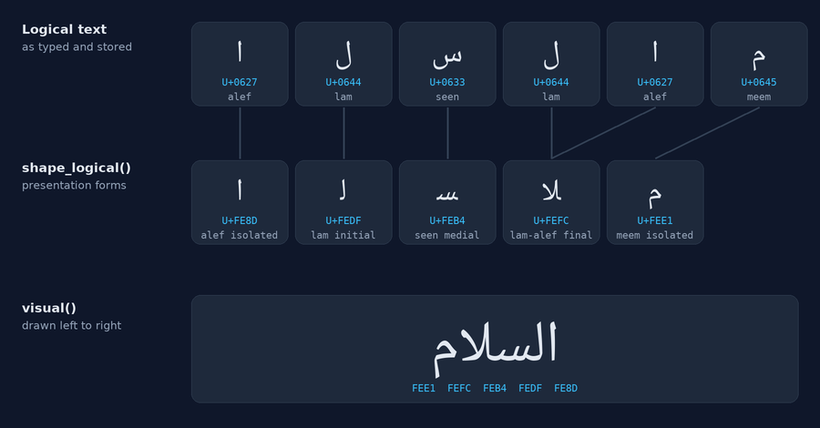

# arabic-shape

Arabic contextual shaping and a small bidi subset for bitmap-font renderers.
`no_std` + `alloc` (disable the default `std` feature).

- `shape_logical`: isolated/initial/medial/final presentation forms,
  lam-alef ligatures, harakat dropped.
- `visual` / `visual_dir`: reorder a line (Arabic, Latin, numbers, mirrored
  brackets) so it can be drawn left to right.
- `has_rtl`, `is_rtl_char`, `rtl_para` helpers.



```rust
use arabic_shape::{shape_logical, visual};
assert_eq!(shape_logical("لا"), ['\u{FEFB}']); // lam-alef ligature
assert_eq!(visual("hello"), "hello");
```

Your font needs the Arabic Presentation Forms (U+FE70-FEFF).
MSRV: Rust 1.74. Part of [featurephone-kit](https://github.com/maxmaster55/featurephone-kit).
Licensed under MIT OR Apache-2.0.
