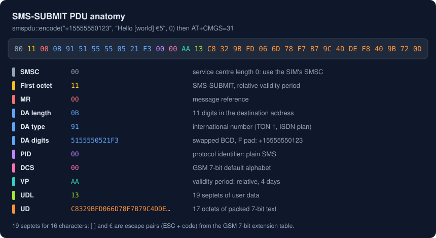

# smspdu

SMS PDU encoder/decoder (3GPP TS 23.040 / 23.038) for modems that only accept
PDU mode. `no_std` + `alloc` (disable the default `std` feature).

- `encode`: SMS-SUBMIT PDUs for `AT+CMGS`; GSM 7-bit with the extension table
  (`€ [ ] { } \ ^ ~ |`), UCS-2/UTF-16 otherwise; automatic concatenation
  (160/153 septets, 70/67 UTF-16 units) that never splits an escape or a surrogate pair.
- `count`: the compose counter (units, capacity, parts, unicode).
- `decode`: SMS-DELIVER and SMS-SUBMIT (7-bit, 8-bit, UCS-2, alphanumeric
  senders, 8/16-bit concatenation headers).



```rust
let parts = smspdu::encode("+15555550123", "Hello [world] €5", 0);
let back = smspdu::decode(&parts[0].hex).unwrap();
assert_eq!(back.text, "Hello [world] €5");
```

MSRV: Rust 1.74. Part of [featurephone-kit](https://github.com/maxmaster55/featurephone-kit).
Licensed under MIT OR Apache-2.0.
