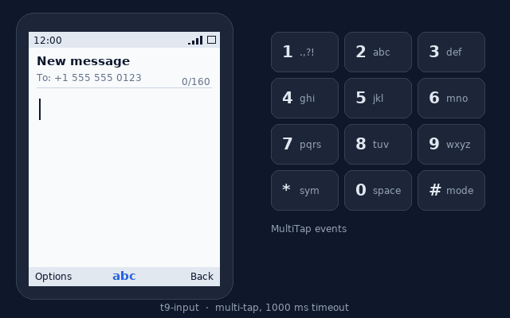

# t9-input

Multi-tap and predictive (T9-style) keypad text input for feature phones and
embedded devices. `no_std` + `alloc` (disable the default `std` feature).

- `MultiTap`: `2` types `a`, tap again within the timeout for `b`, `c`, `2`;
  long-press types the digit; `#` cycles abc / ABC / Arabic / 123; `*` cycles symbols.
- Built-in layouts: text, shell-friendly, and the Arabic phone keypad.
- `Dict`: one key press per letter, ranked completions.
- No clock inside: you pass a millisecond timestamp, so it is trivial to test.



```rust
use t9_input::{apply, Event, Key, Layout, Mode, MultiTap, Outcome};

let mut tap = MultiTap::new(Mode::Lower, Layout::Text);
let mut text = String::new();
for (t, key) in [(0, Key::Digit(2)), (300, Key::Digit(2))] {
    if let Outcome::Edit(e) = tap.key(Event::Press(key), t) {
        apply(&mut text, e, 160);
    }
}
assert_eq!(text, "b");
```

MSRV: Rust 1.74. Part of [featurephone-kit](https://github.com/maxmaster55/featurephone-kit).
Licensed under MIT OR Apache-2.0.
